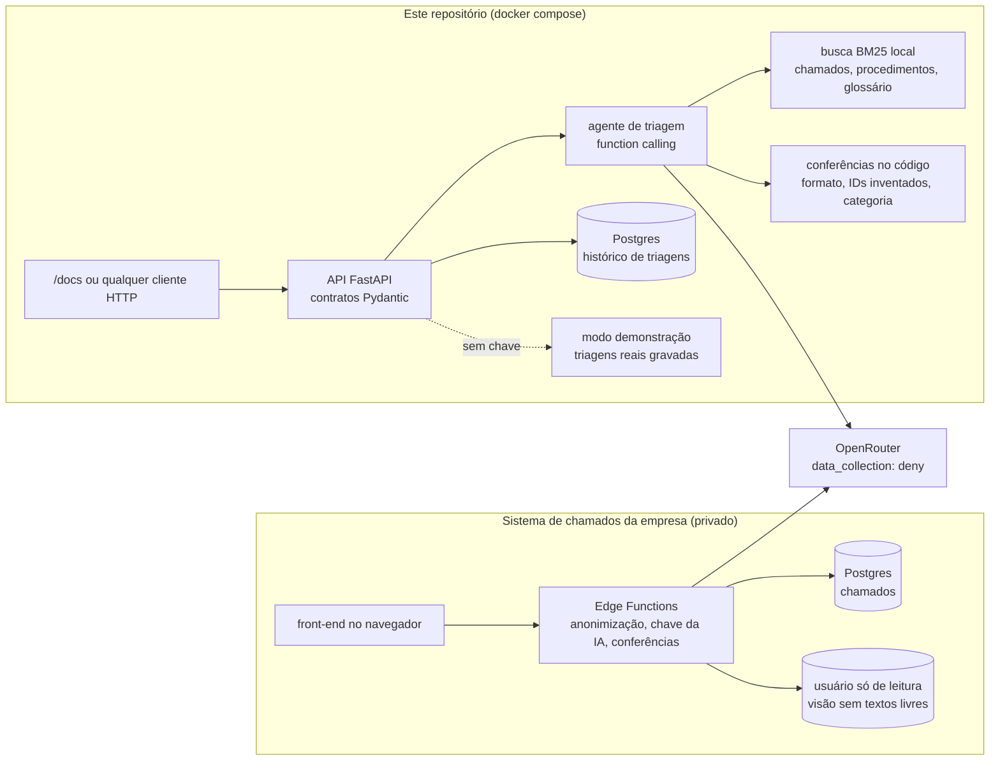

https://github.com/user-attachments/assets/7d38791c-ddbb-4d17-8588-a7b2f24ba1df

# IA aplicada ao suporte de TI

Sou o único analista de suporte de TI de uma consultoria que registra entre 40 e 145 chamados por mês (média de 93 de agosto a outubro de 2026). Este repositório reúne o que construí para tirar trabalho repetitivo do meu dia: classificar e documentar chamados, resumir a semana e responder perguntas sobre os dados, sempre sem expor nada da empresa.

O agente e o sistema de chamados rodam em chamados reais; o onboarding, só com dados de teste. Os números abaixo foram medidos, e cada um diz em quantos chamados.

**Para testar agora, sem chave de API:** `cd agente-triagem && docker compose up --build` e abra http://localhost:8000/docs ([detalhes](agente-triagem#testar-em-2-minutos)).

## Em números

| | |
|---|---|
| **78%** de acerto na categoria e **80%** no tipo do chamado | contra 45% e 50% de quem chuta sempre a resposta mais comum (40 chamados reais, gabarito revisado à mão) |
| **70%** dos passos sugeridos compatíveis com o que eu fiz de verdade | 16 de 23 chamados com resolução escrita, julgados por um modelo de outra empresa, o mesmo para todos os modelos avaliados |
| **US$ 0,003** por chamado | cerca de US$ 3 por mil chamados; a avaliação inteira, com 40 chamados, custou cerca de 12 centavos de dólar, fora o modelo juiz |
| **92%** dos chamados com a sugestão da IA aceita inteira (24 de 26) | categoria, subcategoria, tipo e prioridade, no uso diário, em que a IA parte da minha anotação do que aconteceu, e não do chamado cru (sou o único usuário: aceitar não prova que estava certa) |
| **4 passos** documentados por chamado com IA, contra **1** sem | mediana da linha do tempo em 4 chamados com IA e 11 manuais, de tipos diferentes; registrar com IA ainda não é mais rápido |
| **10 de 10** tentativas de abuso bloqueadas no agente que consulta o banco | DELETE, UPDATE, segundo comando, leitura de arquivo, outras tabelas |

As três primeiras linhas são do DeepSeek V4.1 Flash na avaliação. As duas seguintes são do Claude Haiku 5.5 no uso diário do sistema de chamados ([por que dois modelos](agente-triagem#resultados)).

## O que tem aqui

| Pasta | O que é | Status |
|---|---|---|
| [`agente-triagem`](agente-triagem) | Agente com *function calling* que recebe um chamado e devolve categoria, tipo, prioridade com motivo, recorrência, procedimento e passos. API FastAPI com histórico em Postgres, Docker, testes e a avaliação contra gabarito e linha de base. | avaliado em 40 chamados reais; roda com dados fictícios em um comando |
| [`anonimizador`](anonimizador) | Tira pessoas, logins, e-mails, senhas, empresas, IPs e documentos dos chamados antes de qualquer uso com IA, mantendo as ligações entre registros. | usado em todos os dados do agente |
| [`onboarding`](onboarding) | Automação em n8n: o e-mail do RH vira chamado agendado, usuário e e-mail calculados, rascunho de resposta e lembrete diário. | funciona de ponta a ponta com dados de teste; não implantado |

## O sistema de chamados

O mesmo raciocínio do agente roda dentro do sistema de chamados que construí e uso no meu trabalho, inspirado no ServiceNow. Por enquanto, sou o único usuário. Antes dele, os chamados chegavam por formulário, e-mail e planilha. O código desse sistema fica num repositório privado, porque carrega regras internas da empresa. O que ele faz com IA:

- **Descrever com IA.** Escrevo do meu jeito ("pediu reset, resetei") e a IA preenche o formulário e a linha do tempo, separando o que foi feito do que ficou pendente. O alvo é o maior problema: chamado N1 resolvido no corredor não era registrado. Cerca de 1 em cada 4 chamados registrados é N1. Ainda não consegui medir se o N1 passou a ser mais registrado.
- **Relatório semanal.** Um fluxo no n8n gera um e-mail com volume, categorias, SLA, fila parada e possíveis recorrências, com uma ação sugerida para cada uma. Os números saem do banco; a IA só interpreta. Todo número que ela escreve precisa existir nos dados, senão a frase volta para correção ou é descartada. Testado de ponta a ponta com os chamados reais de uma semana, enviado só para o meu e-mail; ainda não está em uso pelo gestor.
- **Pergunte aos chamados.** Uma pergunta em português ("que setor mais abriu chamado de impressora?") vai para um agente, que decide as consultas SQL, lê os resultados e responde com texto, gráfico e o SQL usado, para conferir. As consultas rodam com um usuário do banco que só lê uma visão sem textos livres. Foi pensado para o gestor; por enquanto, só eu usei.
- **Medição embutida.** Cada registro grava o tempo ativo (aba visível e ação no último minuto), a espera pela IA à parte e quanto da sugestão foi mantido. É daí que vêm os 92%.

## Arquitetura

Dois sistemas usam o mesmo agente. O deste repositório é público e roda com dados fictícios; o da empresa é privado.



## Como funciona

```
chamado / pergunta / semana
   │
   ▼
anonimização ─────── pessoas, e-mails, empresas e senhas viram marcadores
   │
   ▼
modelo via OpenRouter ──► ferramentas: buscar procedimentos, histórico, casos parecidos,
   │                       consultar o banco (só leitura), web
   ▼
conferência no código ── campos obrigatórios, valores permitidos, números que existem nos dados
   │                      └─ se falhar, devolve ao modelo exatamente o que está errado
   ▼
desanonimização ──────── os nomes voltam só na saída, dentro da empresa
```

Três princípios atravessam tudo:

1. **A resposta do modelo é entrada não confiável.** Cada saída passa por conferência no código antes de ser usada.
2. **Conta e regra de negócio ficam no código, não no prompt.** O banco calcula os números, o código decide setor e login. A IA classifica, escreve e interpreta.
3. **Privacidade por padrão.** Todo pedido vai com `data_collection: deny` (só provedores que não treinam com os dados). Preferi pagar centavos a liberar os dados para um modelo gratuito. Nenhum dado, nem anonimizado, está neste repositório.

## Escolhas que foram minhas

O código foi escrito com IA. O que a IA não tinha como saber sozinha foi o meu trabalho:

- **O problema e o contexto:** quais chamados param um setor, o que é o MBOX, por que backup antes de formatar é prioridade alta, por que devolver um notebook não é desligamento.
- **Como medir:** gabarito revisado à mão, linha de base para não se enganar com acerto alto, juiz de outra empresa, tempo ativo em vez de tempo de relógio, espera da IA separada do tempo humano.
- **Duvidar do resultado:** "impressão" virando impressora, "pediu" virando "feito", a IA lendo "resolvidos no primeiro contato" como "primeiro contato feito". Todos apareceram usando o sistema com chamados reais e conferindo a saída.
- **Não trocar variável no meio do experimento:** na avaliação os dois modelos empataram e fiquei com o DeepSeek, que é mais barato, mas o site segue com o Claude Haiku até o fim da medição de tempo, para não misturar os dois modelos nos mesmos números.

## Limitações

- Um único ambiente e 40 chamados na avaliação: é um retrato honesto, não um benchmark.
- O tempo de registro com e sem IA ainda está sendo medido. Até agora, registrar com IA não é mais rápido: mesmo sem a espera pela resposta, leva uns 13 s a mais por chamado. O ganho medido é documentação: 4 passos registrados contra 1. A amostra é pequena (4 chamados com IA e 11 manuais) e enviesada, porque usei a IA nos casos mais longos.
- O onboarding não foi implantado. O relatório semanal e o "Pergunte aos chamados" só foram usados por mim.
- Ainda não há horas economizadas medidas. O que está medido é acerto, custo e quanto fica documentado.
